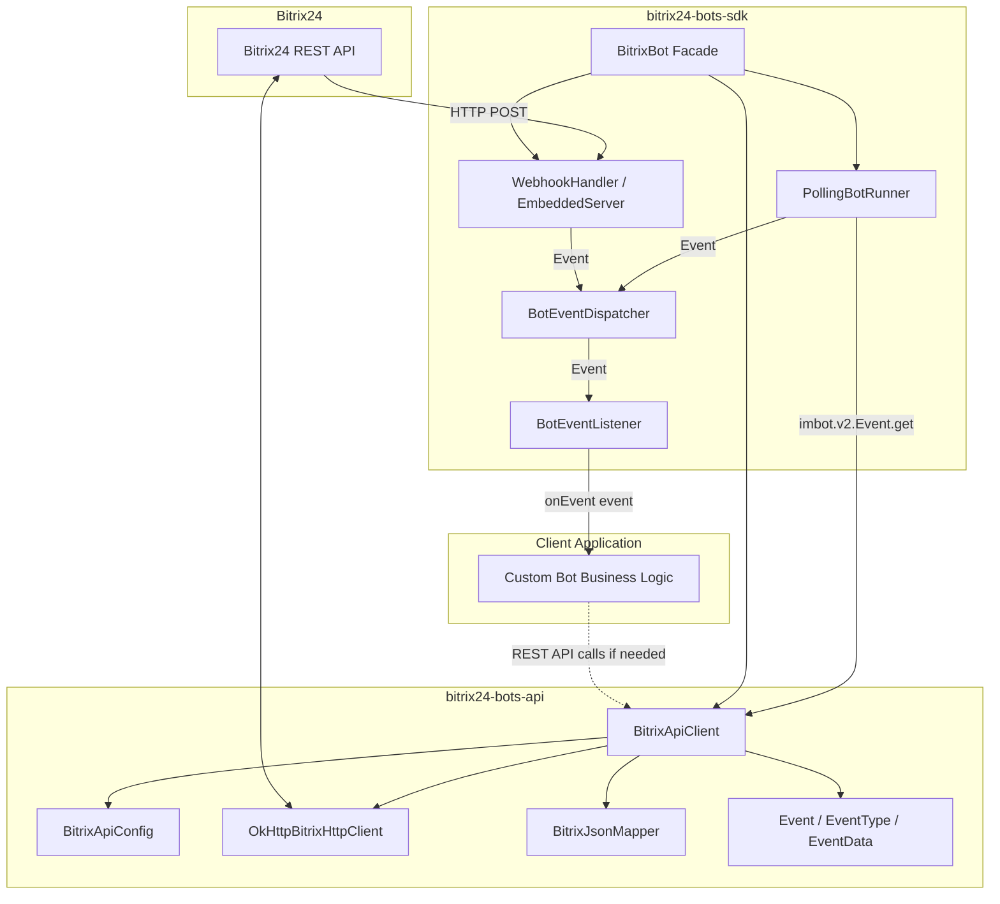

# Bitrix24 Bot SDK & REST API Client for Java (Битрикс24 Чат-боты API / imbot.v2)

[](https://openjdk.org/)
[](LICENSE)
[](https://apidocs.bitrix24.ru/api-reference/chat-bots/chat-bots-v2/index.html)

Высокопроизводительная, легковесная Java 17 библиотека для разработки чат-ботов и интеграции с Битрикс24 по актуальному протоколу **`imbot.v2`**.

Создана без тяжелых веб-фреймворков и контейнеров сервлетов: нулевой оверхед при старте, минимальный footprint памяти и удобный Fluent API.

---

## 🌟 Ключевые возможности

- 🚀 **Актуальный протокол `imbot.v2`:** Поддержка всех методов нового поколения (боты, сообщения, клавиатуры, команды, вложения).
- 🔄 **Два режима доставки событий:**
  - **Polling (FETCH):** Автоматический опрос очереди `imbot.v2.Event.get` с сохранением курсора `offset`, немедленной обработкой бэклога (`hasMore`) и экспоненциальным backoff при сбоях сети. Не требует "белого" IP и SSL-сертификатов — идеально для локальной разработки и AI-агентов.
  - **Webhook:** Прием входящих HTTP POST событий в форматах `application/json` и PHP `application/x-www-form-urlencoded` с валидацией `auth.application_token`.
- ⚡ **Встроенный Webhook-сервер:** Автономный HTTP-сервер на базе стандартного `com.sun.net.httpserver.HttpServer` из JDK 17 (работает "из коробки" без Spring/Tomcat).
- 🧩 **Универсальный WebhookHandler:** Легко встраивается в любой существующий контроллер (Spring MVC, Spring WebFlux, Micronaut, Quarkus, Java Servlets).
- 🔒 **Строгая типизация и безопасность:** DTO с аннотациями Jackson и Lombok, единая модель событий `Event` в модуле `api`, валидация токенов безопасности, автоматическая обработка кодов ошибок REST API.
- 🌐 **Расширяемость:** Универсальный вызов любых методов REST API Битрикс24 (`callMethod` и пакетные вызовы `batch`).

---

## 🏗 Архитектура



---

## 📦 Модули проекта

- **`bitrix24-bots-api`**: DTO запросов и ответов REST API, унифицированная доменная модель событий (`Event`, `EventType`, `EventData`, `ChatInfo`, `MessageInfo`, `UserInfo`, `CommandInfo`, `BotInfo`, `AuthInfo`), HTTP-клиент на OkHttp с пулом соединений, сериализатор Jackson с поддержкой snake_case/camelCase, типизированные API-клиенты (`bot()`, `message()`, `command()`, `event()`) и generic-метод `callMethod`.
- **`bitrix24-bots-sdk`**: Диспетчер `BotEventDispatcher`, функциональный слушатель `BotEventListener`, `PollingBotRunner`, `WebhookHandler`, `EmbeddedWebhookServer` и фасадный класс `BitrixBot`.

---

## 🚀 Быстрый старт

### 1. Подключение зависимостей (Maven)

```xml
<dependencies>
    <dependency>
        <groupId>io.github.AlexeyTsedyakov</groupId>
        <artifactId>bitrix24-bots-sdk</artifactId>
        <version>0.0.1-RC1</version>
    </dependency>
</dependencies>
```

### 2. Режим Polling (FETCH) — локальная разработка

Режим polling не требует настройки веб-сервера или белого IP-адреса. Бот сам периодически забирает новые события из очереди Битрикс24.

```java
import io.github.bitrix24.bots.api.client.BitrixApiClient;
import io.github.bitrix24.bots.api.client.BitrixApiConfig;
import io.github.bitrix24.bots.api.model.chat.SendMessageRequest;
import io.github.bitrix24.bots.sdk.BitrixBot;
import io.github.bitrix24.bots.sdk.config.BotConfig;
import io.github.bitrix24.bots.sdk.config.PollingConfig;

public class MyPollingBot {
    public static void main(String[] args) {
        // Конфигурация подключения через входящий вебхук
        BitrixApiConfig apiConfig = BitrixApiConfig.fromWebhook(
                "https://your-portal.bitrix24.ru/rest/1/webhook-key/",
                123L,                   // botId
                "my_bot_token_secret"   // botToken
        );

        BitrixApiClient client = BitrixApiClient.create(apiConfig);

        // Сборка и запуск бота
        BitrixBot bot = BitrixBot.builder()
                .client(client)
                .botConfig(BotConfig.builder().botId(123L).build())
                .pollingConfig(PollingConfig.builder().intervalMs(1000).build())
                .onEvent(event -> {
                    if (event.isMessage()) {
                        System.out.println("Получено сообщение: " + event.getMessageText());

                        // Эхо-ответ
                        client.message().send(SendMessageRequest.of(
                                event.getDialogId(),
                                "Вы написали: " + event.getMessageText()
                        ));
                    }
                })
                .build();

        // Запуск фонового цикла опроса
        bot.startPolling();
    }
}
```

### 3. Режим Webhook со встроенным сервером

Встроенный веб-сервер слушает входящие POST-запросы от Битрикс24 и проверяет подлинность `application_token`.

```java
import io.github.bitrix24.bots.api.client.BitrixApiClient;
import io.github.bitrix24.bots.api.client.BitrixApiConfig;
import io.github.bitrix24.bots.api.model.chat.SendMessageRequest;
import io.github.bitrix24.bots.sdk.BitrixBot;
import io.github.bitrix24.bots.sdk.config.BotConfig;
import io.github.bitrix24.bots.sdk.config.WebhookConfig;

public class MyWebhookBot {
    public static void main(String[] args) throws Exception {
        BitrixApiClient client = BitrixApiClient.create(
                BitrixApiConfig.fromWebhook("https://portal.bitrix24.ru/rest/1/key/", 123L, "token")
        );

        BitrixBot bot = BitrixBot.builder()
                .client(client)
                .botConfig(BotConfig.builder()
                        .applicationToken("831c76b092f9f135d9b6b36c3a720757") // проверка подлинности вебхука
                        .build())
                .webhookConfig(WebhookConfig.builder()
                        .port(8080)
                        .path("/bitrix24/webhook")
                        .build())
                .onEvent(event -> {
                    if (event.isJoinChat()) {
                        client.message().send(SendMessageRequest.of(
                                event.getDialogId(),
                                "Привет! Я бот Битрикс24."
                        ));
                    }
                })
                .build();

        // Запуск встроенного веб-сервера
        bot.startWebhookServer();
        System.out.println("Вебхук сервер запущен: " + bot.getWebhookServer().getUrl());
    }
}
```

### 4. Интеграция WebhookHandler в существующий Spring MVC / WebFlux контроллер

Если в вашем проекте уже есть веб-сервер, используйте `createWebhookHandler()`:

```java
@RestController
@RequestMapping("/bitrix24")
public class BitrixWebhookController {

    private final WebhookHandler webhookHandler;

    public BitrixWebhookController(BitrixBot bot) {
        this.webhookHandler = bot.createWebhookHandler();
    }

    @PostMapping(value = "/webhook")
    public ResponseEntity<String> handleWebhook(
            @RequestHeader(value = "Content-Type", required = false) String contentType,
            @RequestBody String body) {

        WebhookHandler.WebhookResult result = webhookHandler.handle("POST", contentType, body);
        return ResponseEntity.status(result.getStatusCode())
                .contentType(MediaType.APPLICATION_JSON)
                .body(result.getBody());
    }
}
```

---

## 🔘 Интерактивные клавиатуры и кнопки

Библиотека предоставляет удобный билдер клавиатур под сообщением:

```java
import io.github.bitrix24.bots.api.model.chat.SendMessageFields;
import io.github.bitrix24.bots.api.model.chat.SendMessageRequest;
import io.github.bitrix24.bots.api.model.chat.keyboard.Keyboard;
import io.github.bitrix24.bots.api.model.chat.keyboard.KeyboardButton;

Keyboard keyboard = Keyboard.of(
        // Кнопка вызова команды
        KeyboardButton.command("💡 Помощь", "/help"),
        // Кнопка внешней ссылки
        KeyboardButton.link("🌐 Открыть сайт", "https://example.com"),
        // Кнопка быстрой вставки текста в поле ввода
        KeyboardButton.put("📝 Заполнить шаблон", "Отчет за дату: ")
);

SendMessageRequest request = SendMessageRequest.builder()
        .dialogId("chat5")
        .fields(SendMessageFields.builder()
                .message("Выберите действие:")
                .keyboard(keyboard)
                .build())
        .build();

client.message().send(request);
```

---

## ⌨️ Регистрация и обработка слэш-команд

```java
import io.github.bitrix24.bots.api.model.command.CommandAnswerRequest;
import io.github.bitrix24.bots.api.model.command.CommandRegisterFields;
import io.github.bitrix24.bots.api.model.command.CommandRegisterRequest;

// 1. Регистрация команды
client.command().register(CommandRegisterRequest.builder()
        .botId(123L)
        .fields(CommandRegisterFields.builder()
                .command("status")
                .common(true)
                .build())
        .build());

// 2. Обработка команды в слушателе
bot.onEvent(event -> {
    if (event.isCommand()) {
        String cmd = event.getCommandName();
        if ("/status".equalsIgnoreCase(cmd)) {
            client.command().answer(CommandAnswerRequest.of(
                    event.getData().getCommand().getId(),
                    event.getData().getMessage().getId(),
                    event.getDialogId(),
                    "✅ Сервис работает в штатном режиме"
            ));
        }
    }
});
```

---

## 📎 Загрузка и скачивание файлов (`imbot.v2.File.*`)

Для работы с файлами в `BitrixApiClient` предусмотрен типизированный интерфейс `client.file()` (`FileApi`), поддерживающий загрузку файлов в чат и получение одноразовых ссылок на скачивание.

Протокол `imbot.v2` предоставляет два способа отправки файлов в чат от имени бота:
1. **Загрузка файла на Диск Битрикс24 и отправка в чат (`imbot.v2.File.upload`)** — одним вызовом загружает файл (в формате Base64, до 100 МБ) в папку чата на Диске, прикрепляет его и отправляет сообщение.
2. **Прикрепление внешних файлов по ссылке (блок `FILE` в `Attach`)** — отправляет ссылки на файлы из внешнего хранилища без копирования на Диск Битрикс24.

### 1. Загрузка файла в чат (`imbot.v2.File.upload`)

Метод `client.file().upload(...)` принимает `dialogId` (`chat{chatId}` для группового чата или `{userId}` для личного диалога) и `FileUploadFields` (или напрямую `Path`, `byte[]` либо Base64-строку):
- `name` — имя файла с расширением (например, `report.pdf`);
- `content` — содержимое файла в кодировке Base64 (максимальный размер — 100 МБ);
- `message` *(опционально)* — текст сообщения, отправляемого вместе с файлом.

> **Важно:** метод `imbot.v2.File.upload` не поддерживает вызов внутри пакетных запросов `batch` (`ERROR_BATCH_METHOD_NOT_ALLOWED`).

```java
import io.github.bitrix24.bots.api.model.common.BitrixResponse;
import io.github.bitrix24.bots.api.model.file.FileUploadFields;
import io.github.bitrix24.bots.api.model.file.FileUploadRequest;
import io.github.bitrix24.bots.api.model.file.FileUploadResult;

import java.nio.file.Path;

// Вариант 1: Загрузка файла напрямую из Path (имя файла и Base64 формируются автоматически)
BitrixResponse<FileUploadResult> uploadResponse = client.file().uploadPath(
        "chat5",
        Path.of("report.pdf"),
        "📊 Отчет за текущий период"
);

// Вариант 2: Сборка через DTO FileUploadRequest / FileUploadFields (из byte[] или Base64)
BitrixResponse<FileUploadResult> dtoResponse = client.file().upload(
        FileUploadRequest.builder()
                .dialogId("chat5")
                .fields(FileUploadFields.ofBytes("report.pdf", fileBytes, "📊 Отчет за текущий период"))
                .build()
);

if (uploadResponse.isSuccess()) {
    FileUploadResult result = uploadResponse.getResult();
    Long fileId = result.getFile().getId();
    Long messageId = result.getMessageId();
    System.out.println("Файл загружен! fileId=" + fileId + ", messageId=" + messageId);
} else {
    System.err.println("Ошибка загрузки: " + uploadResponse.getError()
            + " — " + uploadResponse.getErrorDescription());
}
```

### 2. Получение ссылки на скачивание файла (`imbot.v2.File.download`)

Метод `client.file().download(...)` (`imbot.v2.File.download`) возвращает одноразовую авторизованную ссылку (`downloadUrl`) для скачивания файла из чата по его `fileId`:

```java
import io.github.bitrix24.bots.api.model.common.BitrixResponse;
import io.github.bitrix24.bots.api.model.file.FileDownloadResult;

BitrixResponse<FileDownloadResult> downloadResponse = client.file().download(138L);

if (downloadResponse.isSuccess()) {
    String downloadUrl = downloadResponse.getResult().getDownloadUrl();
    System.out.println("Ссылка для скачивания: " + downloadUrl);
}
```

### 3. Отправка внешних файлов по ссылке через вложения (`Attach.addFile`)

Если файл уже размещен на внешнем ресурсе и загружать его на Диск Битрикс24 не требуется, используйте `Attach.addFile(...)` при отправке сообщения (`imbot.v2.Chat.Message.send`):

```java
import io.github.bitrix24.bots.api.model.chat.SendMessageFields;
import io.github.bitrix24.bots.api.model.chat.attach.Attach;

Attach attach = Attach.builder().build()
        .addFile("Отчет за сентябрь.pdf", "https://example.com/files/report-september.pdf", 1_500_000L)
        .addFile("Прайс-лист.xlsx", "https://example.com/files/price-list.xlsx", 48_213L);

client.message().send(
        "chat5",
        SendMessageFields.builder()
                .message("Документы доступны по ссылкам:")
                .attach(attach)
                .build()
);
```

---

## 🛠 Произвольные REST-методы Битрикс24 (Generic API & Batch)

Через `BitrixApiClient` можно вызывать любые доступные методы REST API Битрикс24 (CRM, Задачи, Пользователи):

```java
import io.github.bitrix24.bots.api.model.common.BitrixResponse;
import tools.jackson.databind.JsonNode;
import java.util.Map;

// Вызов любого метода Битрикс24 REST
BitrixResponse<JsonNode> leads = client.callMethod(
        "crm.lead.list",
        Map.of("order", Map.of("ID", "DESC"), "limit", 10),
        JsonNode.class
);

System.out.println("Лиды: " + leads.getResult());

// Пакетный вызов (batch)
BitrixResponse<BatchResult> batchResponse = client.batch(Map.of(
        "user", "user.current",
        "bot", "imbot.v2.Bot.get?botId=123"
));
```

---

## ⚙️ Настройка фильтрации событий (`allowedEvents`)

По умолчанию бот слушает все события протокола `imbot.v2`. Чтобы ограничить обработку только определенными типами и отсечь лишние события на раннем этапе:

```java
BotConfig botConfig = BotConfig.builder()
        .allowedEvents(EnumSet.of(
                EventType.ONIMBOTV2MESSAGEADD,
                EventType.ONIMBOTV2COMMANDADD
        ))
        .build();
```

Доступные типы событий `EventType`:
- `ONIMBOTV2MESSAGEADD` — новое сообщение
- `ONIMBOTV2COMMANDADD` — вызов слэш-команды
- `ONIMBOTV2JOINCHAT` — добавление бота в чат
- `ONIMBOTV2DELETE` — удаление бота
- `ONIMBOTV2MESSAGEUPDATE` — редактирование сообщения
- `ONIMBOTV2MESSAGEDELETE` — удаление сообщения
- `ONIMBOTV2REACTIONCHANGE` — добавление/удаление реакции
- `ONIMBOTV2CONTEXTGET` — передача внешнего контекста диалога

---

## 🧪 Сборка и запуск тестов

Проект собирается с помощью Maven Wrapper:

```bash
# Компиляция и запуск всех модульных и интеграционных тестов
./mvnw test

# Сборка JAR артефактов
./mvnw clean package
```

---

## 📄 Лицензия

Распространяется под лицензией [Apache 2.0](LICENSE).
